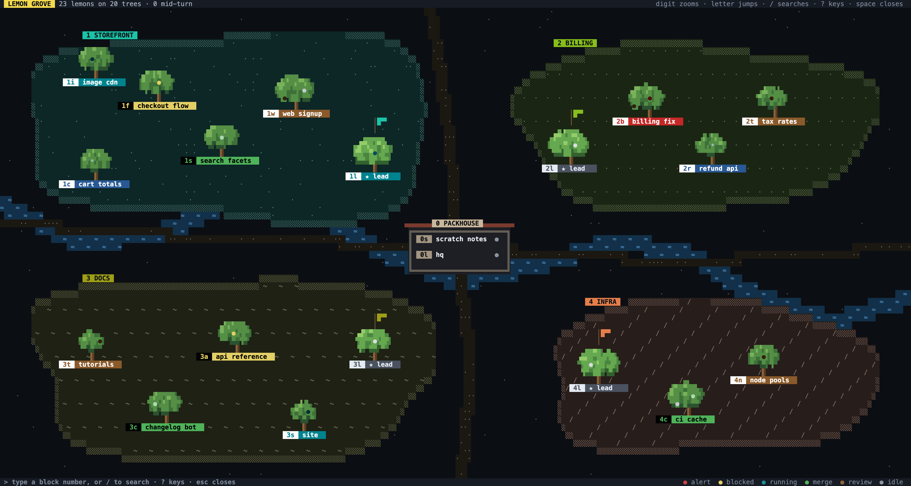
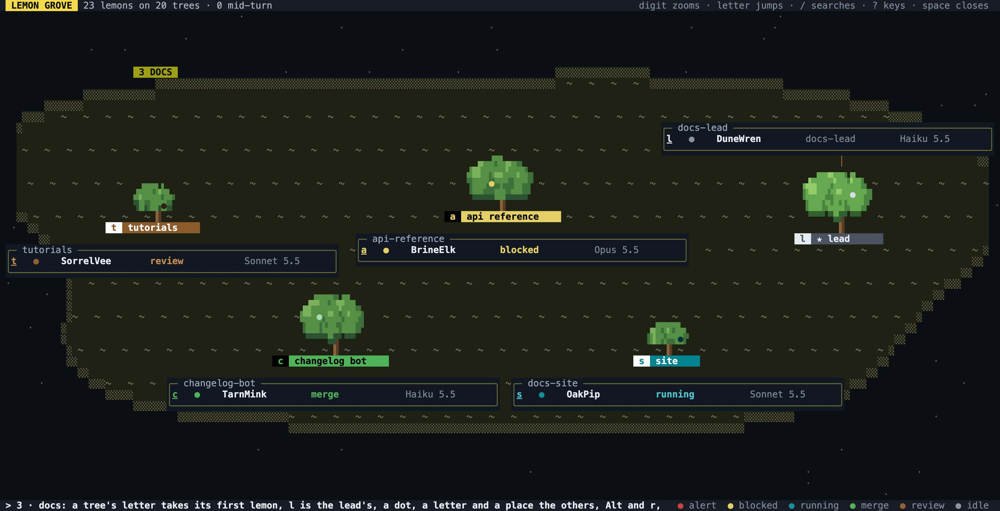

# The grove

> **Beta.** The grove is new and still changing. Its keys, its drawing, its commands and their JSON, and the layout files it keeps (`grove.json` and `grove-view.json` in lemonaid's state directory) may all change between releases without notice or migration. A release may lay out a grove afresh. Don't build on the formats yet.



Zoomed into a block, each tree lists its lemons:



The grove is a map of your lemons that keeps each one in the same place, so you can find a lemon by where it lives instead of scanning a list whose order changes with every status. Press `Space` in `lma` to open it, and `Space` again to close it. In tmux, from the sidebar or any pane too small for a map, it opens in a popup over the whole window instead, with a 3-cell margin (`popup_margin` in `[tmux-session]`). To open that popup from anywhere, bind a tmux key by adding what this prints to your tmux.conf:

```sh
lemonaid tmux popup grove --binding Space --title ' lemon grove '
```

This replaces tmux's default `prefix Space` (`next-layout`). Choosing a lemon in the popup switches the window you opened it over to that lemon and closes the popup.

The popup is lemonaid's fast tmux popup, which any app can use: the grove keeps running in a hidden tmux session named `_lma_grove`, as the scratch pane's inbox lives in `_lma_scratch`, and the popup shows that session, already drawn. `lma` starts it in the background when it opens inside tmux, and one from an older install is replaced. There is one grove, so opening it on one client closes it on any other, and a choice always switches the client it shows on. See [tmux.md](tmux.md#fast-popups).

- **A group is a block:** a patch of ground with its own color, outline, texture and signpost.
- **A tree is a terminal session** (a tmux session; for lemons outside one, their directory). An author and its reviewer share a tree. Its tag shows the name given to its main lemon, in the inbox or with `inbox rename`, and otherwise its session's name, after the main lemon's emoji (`inbox emoji`). A `▐` just left of the tag means the main lemon is pinned.
- **Lemons hang on their tree,** colored by brief status: the inbox's yellow for `blocked`, green for `merge`, brown for `review`, red for `alert`, teal for `running`, blue (hollow) for `done`, grey otherwise. A lemon mid-turn gently dims and brightens over 4.5 seconds, staying visible throughout, and its tree's tag pulses with it. Idle lemons are dimmed but never hidden: the grove shows hidden and folded lemons too, so nothing moves out of its spot.
- **The lead tree** (the group's lead, as the inbox works it out) stands nearest the packhouse, flies a pennant in its block's color, and has a crown (`♛`, as in the inbox) and the letter `l`, and its lead lemon comes first on it. HQ, the lead of the lemons in no group, gets `l` in the packhouse.
- **The packhouse** at the grove's middle holds the lemons in no group, HQ among them, each session as a bay. It's numbered `0`.
- **Roads and a stream** are landmarks: laid once, saved with the layout, and drawn under the blocks so they show in the gaps. A road crosses the stream on a bridge.

## Keys

| Keys | What they do |
|------|--------------|
| a digit | Zoom into that block. The inbox shows each lemon's key on its row, and typing one there jumps the same way. Blocks are numbered in the inbox's group order, so `2` is the second group in your list; lemons in no group are `0`. A second digit reaches block 10 and up (`1` `0`). |
| a letter | Jump to the first lemon on that tree, its main lemon, however many lemons join it. `l` is the lead tree. |
| a dot, a letter, then a number | Another lemon on that tree: the number counts from the first, so `.s1` is the second lemon, such as a reviewer, and `.s2` the third. Past `.s9` they are `0` and a letter (`.s0a` is the eleventh). `.s` on its own waits for the number; `esc` backs out. A tree's main lemon is always first: a lemon whose brief is hidden (a reviewer's) comes after one whose brief isn't, then the lower window, then the older lemon. |
| arrows | Pan the grove when it is too big for the screen, 2 columns or 1 row at a time (`grove_pan_columns` and `grove_pan_rows` in `[tui]`); it shrinks to fit only so far, so its trees stay readable. |
| `Shift` and an arrow | Move the view a whole screen that way. |
| `Shift` and a digit | Jump to a screen-sized part of the grove around the packhouse: `1` north, then clockwise to `8` north-west (`!@#$%^&*` on a US keyboard). `Shift`+`0` or `Home` centers the packhouse. `Alt` and a digit does the same on any keyboard. The grove opens where you left it. |
| `/` | Search Brief-IDs, then sessions and names. Blocks without a match fade; when every match is in one block, the grove zooms to it. `↑`/`↓` choose, `enter` jumps. |
| `esc` | Back out one step: out of a tree, out of a block, out of the grove. |
| `Tab` | Enter [select mode](#select-mode), where keys choose a lemon or a tree without jumping, show its card, and rename, snooze, archive, pin, move or recolor it. |
| `q` | Close the grove at once, from anywhere but where you're typing, a search or an edit's dialog, which take it as text: `lma` returns to the inbox and the popup hides. |
| `Q` | Quit the process the grove runs in (`lma`, or the popup's resident, which the next opening starts afresh); it too is text in a search or a dialog. |
| `Space` | Close the grove from anywhere in it, except while typing a search. |
| `?` | List every key for the view you're in, the grove or a block. Any key closes the list. |
| hold `;` | In a block, show each lemon's PR numbers and branch (or directory) where its name was, its model where its Brief-ID was, and its context use where its age was. In the grove view, each tree's tag shows how many of its lemons are mid-turn of how many, its fullest context and how long since its latest report (`1/3 · 88% · 4m`) in place of its name. Let go to see names again. See `grove_flip` in [config.md](config.md) for a key that toggles instead, or a different key. |

So `2c` always means the same tree and its main lemon, `2C2` its second lemon, and `2C3` the third. In the grove view each tag shows its tree's whole key, as `2c`; zoomed into a block, just the letter. A click on a block zooms into it, and a click on a tree acts like its letter.

Zoomed into a block, each tree lists its lemons by session name, with their Brief-ID and how long since each reported (`4m`). A status that asks for you (`blocked`, `alert`, `merge`, `approve`) is named beside the session as well; every status colors the lemon's key. Each lemon's emoji follows its key, and a pinned lemon's row has a `▐` in the list's left border. A list is 30% of the screen's width, from 54 to 72 columns; the extra goes to the session name.

Change the key with `grove` in `[tui.keybindings]`.

## Select mode

Select mode is for looking at a lemon, or changing it, without jumping to it. `Tab` enters it (`grove_select_key` in `[tui]`), and the screen's edges and its title and prompt bars turn yellow while it's on. `esc`, or `Tab` again, leaves it. While it's on, each tree's tag in a block shows `$` before its letter, as `$s`, and each packhouse bay's title does too: that's what chooses the whole tree.

| Keys | What they choose or do |
|------|------------------------|
| a digit | That block, as in jump mode. |
| a letter | The first lemon on that tree. `l` is the lead tree. |
| a dot, a letter, a place | Another lemon on that tree, as `.s1`; past nine, `0` and a letter. |
| `$`, a letter | The whole tree, to edit every lemon on it at once, or to move it. |
| `↑`, `↓` | With a lemon chosen, the next or previous lemon on its tree. |
| arrows | With a whole tree chosen, move it a step within its block, or five with `Shift`. A step onto another tree hops past it to the next spot that's clear; a step it can't take at all flashes the tree red and leaves it where it was. The move is saved once the arrows stop, or at the next other key. The packhouse's bays don't move. |
| `r`, `s`, `a`, `p`, `g`, `c` | With a tree or a lemon chosen: rename, snooze, archive, pin or unpin, move to another group, or recolor its block. A whole tree's edit covers each of its lemons, and a rename of a whole tree renames its tmux session where the tree is one; a session keeps its tree's spot and letter. A lemon's rename gives it a display name, as `r` does in the inbox, and an empty name clears it. Archive and pin happen at once; snooze asks how long and moving asks which group, in the inbox's own dialogs. A lemon moved to another group leaves the group it was drawn in. `c` recolors the tree's block; the packhouse has no color. |
| `enter`, `o` | Jump to the chosen lemon, or the chosen tree's first lemon. |
| `backspace` | Back to the block, then out of it. |
| `/` | Search; `enter` chooses the match rather than jumping to it. |

The chosen lemon's card opens beside its tree's list, above or below it, wherever the screen has more room, and covers whatever is there. It is the inbox's card for that lemon: its session name and Brief-ID, model and context use, status, what it needs, project and branch, PRs, how long ago it reported, and the start of its last message. A chosen tree shows its first lemon's card. The card hides while you drag.

With only a block chosen, a letter chooses a tree rather than editing; to recolor the block, choose any of its trees and press `c`.

## Gardening

Drag with the mouse to rearrange the grove. It's saved when you let go, and `esc` while dragging puts it back. A tree also moves with the arrow keys in [select mode](#select-mode), once `$` and its letter choose it.

- **In the grove view, drag a block to move it.** Its trees move with it.
- **Drag a block's edge or corner to resize it.** Its trees stay where they stand on the ground, but for those the moving edge would cut off, which it pushes back onto the block.
- **Zoomed into a block, drag a tree to move it** within its block. The packhouse's bays stay in order.
- **Zoomed into a block, drag a bare tree to move it, or off its block's ground to clear it.** A cleared bare tree's spot and letter are forgotten at once, as they otherwise are after 30 days; if its session comes back, it stands afresh.

The prompt line says what you're moving, or why it can't go there. A block can't go onto another block's ground or past the grove's top or left edge, and a block can't be made too small for its trees to stand in without standing on each other. A tree can't go onto another tree or past its block's edge. A bare tree can't go onto a tree.

## Places that stay put

The first time lemonaid sees a group it gives it a plot of ground near the middle of the grove, and the first time it sees a tree it gives the tree a spot in its block, as near the block's lead as it fits with room to spare (else near its first tree, and a block's first tree near the packhouse), and a letter, taken from the words that tell it apart. Neither moves after that, unless you drag it. A tree with no room left in its block takes more ground for the block, on whichever side is free of other blocks; when none is, it stands just past the block's edge, where the block's view still shows it, and `lemonaid grove resize` or `move` makes room.

- **A group that ends leaves open ground.** The outline stays, unnamed, and the next new group takes the open ground nearest the middle, so the grove doesn't hollow out.
- **A tree that goes leaves a bare tree, with no leaves, in its spot.** The spot is kept for 30 days in case its session comes back; the next new tree in that block takes the oldest free spot. You can move a bare tree or clear it away (see [Gardening](#gardening)).
- **New trees start small.** A tree whose oldest lemon is less than a day old is a sapling, and under three days a young tree. Every tree in a crowded block is drawn smaller, and grows again as the block empties.
- **Reordering groups renumbers blocks** but doesn't move them, so the digits always match the inbox.

The layout is saved in `grove.json` in lemonaid's state directory (`~/.local/state/lemonaid`, or `LEMONAID_STATE_DIR`), per machine.

## From the command line

```bash
lemonaid grove open              # the grove full-screen here; choosing a lemon switches to it
lemonaid tmux popup grove        # the same, in a tmux popup over this client
lemonaid grove show              # draw the grove in this terminal, once
lemonaid grove show 2            # draw block 2 zoomed in
lemonaid grove show --plain      # characters only
lemonaid grove show --json       # blocks, trees, spots, letters and lemons
lemonaid grove move 2 40 10      # put block 2's top-left corner at column 40, row 10
lemonaid grove resize oria 60 18 # by digit or by group name
lemonaid grove reshape 2 6       # 2 is an ellipse, 12 nearly a rectangle
lemonaid grove clear-open        # forget open ground left by groups that ended
```

The grove is 210 columns by 60 rows at full size. A larger grove is drawn smaller to fit the screen. `show --json` is meant for lemons: one can read the layout, propose a tidier one, and apply it with `move`, `resize` and `reshape` once you agree.
