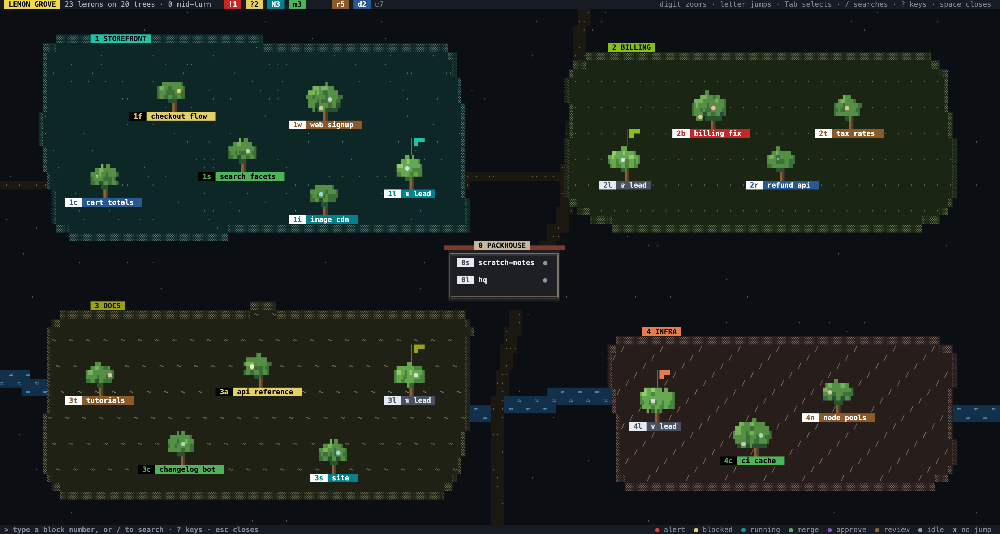
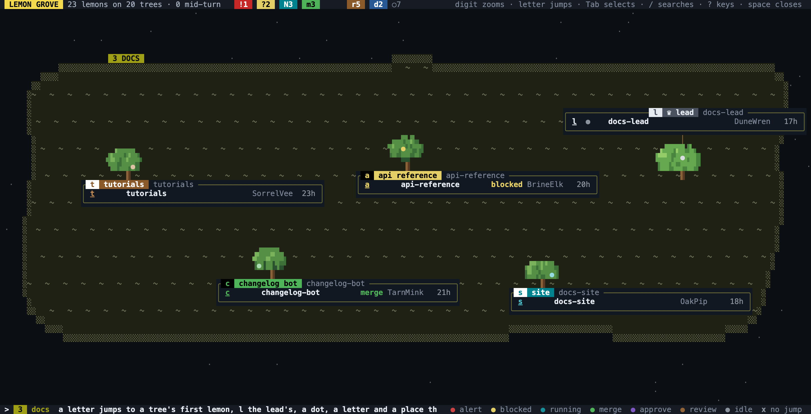
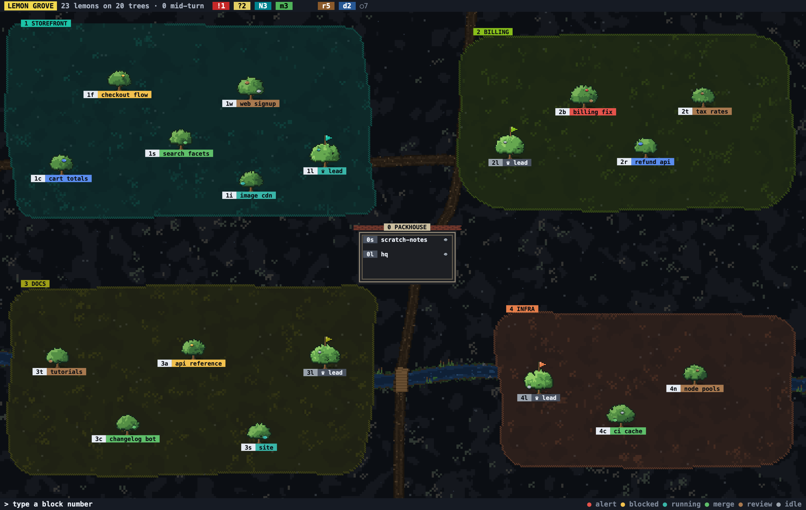

# The grove

> **Beta.** The grove is new and still changing. Its keys, its drawing, its commands and their JSON, and the layout files it keeps (`grove.json` and `grove-view.json` in lemonaid's state directory) may all change between releases without notice or migration. A release may lay out a grove afresh. Don't build on the formats yet.



Zoomed into a block, each tree lists its lemons:



The grove is a map of your lemons that keeps each one in the same place, so you can find a lemon by where it lives instead of scanning a list whose order changes with every status. Press `Space` in `lma` to open it, and `Space` again to close it. Clicking the attention bar at the top of the inbox or of the brief view opens it the same way, unless `grove` is unset in `[tui.keybindings]`. In tmux, from the sidebar or any pane too small for a map, it opens in a popup over the whole window instead, with a 3-cell margin (`popup_margin` in `[tmux-session]`). To open that popup from anywhere, bind a tmux key by adding what this prints to your tmux.conf:

```sh
lemonaid tmux popup grove --binding Space --title ' lemon grove '
```

This replaces tmux's default `prefix Space` (`next-layout`). Choosing a lemon in the popup switches the window you opened it over to that lemon and closes the popup.

A lemon whose recorded tmux pane is missing or cannot be verified shows an `x` and a `no jump` label, while keeping its brief status color. Select it or find it with `/` to see why the jump is unavailable. A lemon lost with its tmux server says to run `lemonaid restore` to bring it back, or `lemonaid restore dismiss <channel>` to clear it. Its blocked request stays visible even after its terminal has gone; use the inbox to inspect its brief and resume it when appropriate.

The popup is lemonaid's fast tmux popup, which any app can use: the grove keeps running in a hidden tmux session named `_lma_grove`, as the scratch pane's inbox lives in `_lma_scratch`, and the popup shows that session, already drawn. `lma` starts it in the background when it opens inside tmux, and one from an older install is replaced. There is one grove, so opening it on one client closes it on any other, and a choice always switches the client it shows on. See [tmux.md](tmux.md#fast-popups).

- **A group is a block:** a patch of ground with its own color, outline, texture and signpost.
- **A tree is a terminal workspace** (a tmux session or a WezTerm workspace; for lemons outside both, their directory). An author and its reviewer share a tree. Its tag shows the name given to its main lemon, in the inbox or with `inbox rename`, and otherwise its session's name (except in the packhouse, where a bay holding one lemon shows that lemon's name, as the inbox does, since tmux's own session names like `22` say nothing), after the main lemon's emoji (`inbox emoji`). A `▐` just left of the tag means the main lemon is pinned.
- **Lemons hang on their tree,** colored by brief status: the inbox's yellow for `blocked`, green for `merge`, brown for `review`, red for `alert`, teal for `running`, blue (hollow) for `done`, grey otherwise. A lemon mid-turn gently dims and brightens over 4.5 seconds (`grove_pulse_seconds` in `[tui]`), in 64 steps, staying visible throughout, and its tree's tag pulses with it. Idle lemons are dimmed but never hidden: the grove shows hidden and folded lemons too, so nothing moves out of its spot.
- **The lead tree** (the group's lead, as the inbox works it out) stands nearest the packhouse, flies a pennant in its block's color, and has a crown (`♛`, as in the inbox) and the letter `l`, and its lead lemon comes first on it. HQ, the lead of the lemons in no group, gets `l` in the packhouse.
- **The packhouse** at the grove's middle holds the lemons in no group, HQ among them, each session as a bay. It's numbered `0`.
- **Roads and a stream** are landmarks: laid once, saved with the layout, and drawn in the gaps between blocks. No block but the packhouse stands on them. A road crosses the stream on a bridge.

## The title bar

The title row shows how many lemons there are, then the attention bar: the same status chips as the inbox (`?4 N1 m3 r13 d1`), with each status in its own fixed slot so a chip stays put when another appears or goes. Lemons whose brief has no status that has a chip are counted together as `○n`.

On a narrow screen the key hints give way first, a hint at a time from the left, then the whole bar if it still can't sit beside the lemon count.

## Keys

| Keys | What they do |
|------|--------------|
| a digit | Zoom into that block. The inbox shows each lemon's key on its row, and typing one there jumps the same way. While you type, the inbox lists only that block, every lemon in it even in attention mode, grouped by tree as the grove lists them (a tree's main lemon with its reviewers right below it), and marks the lemons of the tree you've reached (`5.e`) with `▸`; `esc` or `backspace` returns the inbox as it was. Blocks are numbered in the inbox's group order, so `2` is the second group in your list; lemons in no group are `0`. A second digit reaches block 10 and up (`1` `0`). |
| a letter | Jump to the first lemon on that tree, its main lemon, however many lemons join it. `l` is the lead tree. |
| a dot, a letter, then a number | Another lemon on that tree: the number counts from the first, so `.s1` is the second lemon, such as a reviewer, and `.s2` the third. Past `.s9` they are `0` and a letter (`.s0a` is the eleventh). `.s` on its own waits for the number; `esc` or `backspace` backs out. A tree's main lemon is always first: a lemon whose brief is hidden (a reviewer's) comes after one whose brief isn't, then a lemon comes after its parent (as `lemonaid lemon parent` records it) on the same tree, then the lower window, then the older lemon. |
| arrows | Pan the grove when it is too big for the screen, 2 columns or 1 row at a time (`grove_pan_columns` and `grove_pan_rows` in `[tui]`); it shrinks to fit only so far, so its trees stay readable. |
| `Shift` and an arrow | Move the view a whole screen that way. |
| `Shift` and a digit | Jump to a screen-sized part of the grove around the packhouse: `1` north, then clockwise to `8` north-west (`!@#$%^&*` on a US keyboard). `Shift`+`0` or `Home` centers the packhouse. `Alt` and a digit does the same on any keyboard. The grove opens where you left it. |
| `/` | Search Brief-IDs, then sessions and names. Blocks without a match fade; when every match is in one block, the grove zooms to it. `↑`/`↓` choose, `enter` jumps. |
| `esc` | Back out one step: out of a tree, out of a block, out of the grove. |
| `backspace` | Clear the part of a key typed after the block's digit (`.s1`), then zoom back out to the whole grove, then close the grove as `esc` does. It closes the grove only after a pause: once a Backspace has cleared something, each Backspace that follows within 0.6 seconds of the one before does nothing, so a held or double-tapped Backspace stops at the whole grove. In the inbox, it clears what was typed so far and closes the key bar, which, like the grove's prompt line, shows the typed key in its block's color. |
| `Tab` | Enter [select mode](#select-mode), where keys choose a lemon or a tree without jumping, show its card, and rename, snooze, archive, pin, move or recolor it. |
| `q` | Close the grove at once, from anywhere but where you're typing, a search or an edit's dialog, which take it as text: `lma` returns to the inbox and the popup hides. |
| `Q` | Quit the process the grove runs in (`lma`, or the popup's resident, which the next opening starts afresh); it too is text in a search or a dialog. |
| `Space` | Close the grove from anywhere in it, except while typing a search. |
| `?` | List every key for the view you're in, the grove or a block. Any key closes the list. |
| `U` | Show usage for each limit window over the grove, as in the inbox (`usage_view` in `[tui.keybindings]`); `U`, `q`, `Escape` or `Backspace` closes it. It is text in a search, and a letter after a dot. |
| hold `;` | In a block, show each lemon's PR numbers and branch (or directory) where its name was, its model where its Brief-ID was, and its context use where its age was. In the grove view, each tree's tag shows how many of its lemons are mid-turn of how many, its fullest context and how long since its latest report (`1/3 · 88% · 4m`) in place of its name. Let go to see names again. See `grove_flip` in [config.md](config.md) for a key that toggles instead, or a different key. |

So `2c` always means the same tree and its main lemon, `2C2` its second lemon, and `2C3` the third. In the grove view each tag shows its tree's whole key, as `2c`; zoomed into a block, just the letter. A click on a block zooms into it, and a click on a tree acts like its letter. Clicking a linked PR number opens it in your browser without switching lemons; this works in the block's flipped list and in select mode's card. Terminal modifier-click links remain available.

Zoomed into a block, each tree lists its lemons by session name, with their Brief-ID and how long since each reported (`4m`). A status that asks for you (`blocked`, `alert`, `merge`, `approve`) is named beside the session as well; every status colors the lemon's key. Each lemon's emoji follows its key, and a pinned lemon's row has a `▐` in the list's left border. A list is 30% of the screen's width, from 54 to 72 columns; the extra goes to the session name. Each list sits at its own tree: it hangs from the tree's tag, so the tag is its title, else it goes above the crown, else right of it. Its title is the tree's tag followed by the place key, so a list reads as its tree's even where a crowded block makes lists overlap.

Change the key with `grove` in `[tui.keybindings]`.

## Select mode

Select mode is for looking at a lemon, or changing it, without jumping to it. `Tab` enters it (`grove_select_key` in `[tui]`), and the screen's edges and its title and prompt bars turn yellow while it's on. `esc`, or `Tab` again, leaves it. While it's on, each tree's tag in a block shows `$` before its letter, as `$s`, and each packhouse bay's title does too: that's what chooses the whole tree.

| Keys | What they choose or do |
|------|------------------------|
| a digit | That block, as in jump mode. |
| a letter | The first lemon on that tree. `l` is the lead tree. |
| a dot, a letter, a place | Another lemon on that tree, as `.s1`; past nine, `0` and a letter. |
| `$`, a letter | The whole tree, to edit every lemon on it at once, or to move it. |
| `↑`, `↓` | With a lemon chosen, the next or previous lemon on its tree. |
| arrows | With a whole tree chosen, move it a step within its block, or five with `Shift`. A step onto another tree hops past it to the next spot that's clear; a step it can't take at all flashes the tree red and leaves it where it was. The move is saved once the arrows stop, or at the next other key. The packhouse's bays don't move. |
| `r`, `s`, `a`, `p`, `g`, `c` | With a tree or a lemon chosen: rename, snooze, archive, pin or unpin, move to another group, or recolor its block. A whole tree's edit covers each of its lemons, and a rename of a whole tree renames its tmux session where the tree is one; a session keeps its tree's spot and letter. A lemon's rename gives it a display name, as `r` does in the inbox, and an empty name clears it. Archive and pin happen at once; snooze asks how long and moving asks which group, in the inbox's own dialogs. A lemon moved to another group leaves the group it was drawn in. `c` recolors the tree's block; the packhouse has no color. |
| `enter`, `o` | Jump to the chosen lemon, or the chosen tree's first lemon. |
| `backspace` | Back to the block, then out of it. |
| `/` | Search; `enter` chooses the match rather than jumping to it. |

The chosen lemon's card opens beside its tree's list, above or below it, wherever the screen has more room, and covers whatever is there. It is the inbox's card for that lemon: its session name and Brief-ID, model and context use, status, what it needs, project and branch, PRs, how long ago it reported, and the start of its last message. A chosen tree shows its first lemon's card. The card hides while you drag.

With only a block chosen, a letter chooses a tree rather than editing; to recolor the block, choose any of its trees and press `c`.

## Gardening

Drag with the mouse to rearrange the grove. It's saved when you let go, and `esc` while dragging puts it back. While a drag is somewhere it can't be dropped, what you're dragging turns red and the bottom line says why in red; both clear as soon as it can drop there. A tree also moves with the arrow keys in [select mode](#select-mode), once `$` and its letter choose it.

- **In the grove view, drag a block to move it.** Its trees move with it.
- **Drag a block's edge or corner to resize it.** Its trees stay where they stand on the ground, but for those the moving edge would cut off, which it pushes back onto the block.
- **Zoomed into a block, drag a tree to move it** within its block. It stays wherever its trunk and the tag it stands on are on the block's ground, its crown is within the block's sides (it may rise above the top), and it isn't on another tree; anywhere else turns red, naming the edge or the tree in the way. The packhouse's bays stay in order.
- **Zoomed into a block, drag a bare tree to move it, or off its block's ground to clear it.** A cleared bare tree's spot and letter are forgotten at once, as they otherwise are after 30 days; if its session comes back, it stands afresh.

The prompt line says what you're moving, or why it can't go there. A block can't go onto another block's ground, a road or the stream, or past the grove's top or left edge, and a block can't be made too small for its trees to stand in without standing on each other. A tree can't go onto another tree or past its block's edge. A bare tree can't go onto a tree.

## Places that stay put

The first time lemonaid sees a group it gives it a plot of ground near the middle of the grove, and the first time it sees a tree it gives the tree a spot in its block, as near the block's lead as it fits with room to spare (else near its first tree, and a block's first tree near the packhouse), and a letter, taken from the words that tell it apart. Neither moves after that, unless you drag it. A block keeps its size and shape however many trees it gains. Its plot is sized for its first trees and one more; past that, a new tree is drawn smaller and squeezed in where it covers the least of the others, and nearer trees are drawn in front. `lemonaid grove resize` gives a full block more room.

- **A group that ends leaves open ground.** The outline stays, unnamed, and the next new group takes the open ground nearest the middle, so the grove doesn't hollow out. You can drag open ground (its middle moves it, its edge resizes it) or address it as `open:N`, its position in `show --json`'s `open` list. A block moved, resized or dropped over open ground takes that ground over.
- **A tree that goes leaves a bare tree, with no leaves, in its spot.** The spot is kept for 30 days in case its session comes back; the next new tree in that block takes the oldest free spot. You can move a bare tree or clear it away (see [Gardening](#gardening)).
- **New trees start small.** A tree whose oldest lemon is less than a day old is a sapling, and under three days a young tree. Every tree in a crowded block is drawn smaller, and grows again as the block empties.
- **Reordering groups renumbers blocks** but doesn't move them, so the digits always match the inbox.

The layout is saved in `grove.json` in lemonaid's state directory (`~/.local/state/lemonaid`, or `LEMONAID_STATE_DIR`), per machine.

## The grove window (beta, macOS)

The grove can also open in a native window that covers your terminal's window, drawn in pixels rather than terminal cells: finer trees, smaller text, smooth zoom, and the grove's layout from the same `grove.json`. It is a second view of the grove, and the inbox and the terminal grove keep working as before.



### Setting it up

A lemon can do this with you: ask it to set up the grove window, and it follows [for-lemons.md](for-lemons.md#setting-up-a-persons-tmux-keys). By hand:

1. Install lemonaid with the `web` extra (`pywebview`, which uses the system's WebKit). It runs on macOS only.

   ```sh
   uv tool install --force 'lemonaid-inbox[web]'
   ```

2. Add the summon key to `~/.tmux.conf`. This prints its lines, for `prefix Space` unless you pass `--key`:

   ```sh
   lemonaid grove window binding >> ~/.tmux.conf
   tmux source-file ~/.tmux.conf
   ```

3. Press `prefix Space` in any pane. The first press starts the window in a hidden tmux session, `_lma_grove_window`, which takes a few seconds; later presses show it at once.

The key replaces tmux's `next-layout`. Its lines work unchanged on other systems, where it opens the [terminal grove's popup](#the-grove) instead, so one tmux.conf serves every machine. To keep the terminal grove on a key of its own as well, bind its popup to `G` (see [the keys that work from any pane](tmux.md#keys-that-work-from-any-pane)).

The key writes to the window's socket (`grove-window.sock` in lemonaid's state directory) with `nc -U` rather than running `lemonaid`, so the window appears at once. It covers the window of whichever app was in front when you pressed it, and hands that app the focus back when it closes.

#### Where the window opens

At first the window covers the terminal you summon it from, and hides once you choose a lemon. Drag its top bar to move it, or an edge to resize it, and leave it away from the terminal, say on another display: from then on it opens there, and stays up after you choose a lemon, giving the terminal the focus while the window stays in view. Move it back over the terminal and it covers the terminal again. The top bar says which: `over terminal`, or `floating`, which a click puts back over the terminal. Either way, after a jump it goes back to the whole grove. `Space`, or `esc` and `backspace` from the whole grove, go back to the terminal the same way, leaving a floating window up; `q` closes it.

Each set of displays, arranged as it is, keeps its own place, since macOS doesn't: the window remembers where you left it on the laptop alone and where you left it at your desk. With a set it hasn't seen, it covers the terminal. Connect or disconnect a display while it's up and it moves to its place for the new set.

It counts as over the terminal when it covers a tenth or more of the terminal's window (`grove_window_cover_share` under `[tui]`; see [config](config.md)).

#### Other terminals

The window isn't tied to tmux. Anything that can run a command can summon it: `lemonaid grove window show`, or, faster, a line written to its socket, as the tmux key does. Keep `lemonaid grove window run` running yourself, in a tab of its own or at login. In WezTerm, for example, a key in `wezterm.lua`:

```lua
{ key = "Space", mods = "LEADER", action = wezterm.action_callback(function()
  wezterm.background_child_process({ "sh", "-c",
    'echo show | nc -U "${LEMONAID_STATE_DIR:-$HOME/.local/state/lemonaid}/grove-window.sock"' })
end) },
```

Choosing a lemon switches to it the way the inbox does, through the front end it runs in: tmux, WezTerm or cmux. A tmux lemon switches the tmux client the window was summoned over; one whose pane is gone is resumed, as the inbox resumes it, unless it was lost with its tmux server, which `lemonaid restore` brings back.

### When the window doesn't appear

- **The key says the window did not start:** run `lemonaid grove window run` in a pane to see why, usually a missing `web` extra. Once it runs, leave it there or press the key again from another pane.
- **Nothing happens at all:** check the key is bound with `tmux list-keys -T prefix Space`.
- **Something else:** the window logs to `/tmp/lemonaid.log` (`$LEMONAID_LOG` when set) as `lemonaid.grove.window`, including the window it covered each time it was shown.

After upgrading lemonaid, `tmux kill-session -t _lma_grove_window` so that the next press starts the new build.

### Using it

- **The grove view** shows every block with each tree's tag under its trunk; a digit, or scrolling in, zooms into a block, where each tree's lemon list hangs under it with its tag as the title.
- **Choosing:** a click on a tree, or a letter in a block, switches the tmux client you summoned it from to the tree's first lemon and hides the window. A click on a lemon's row in a list, or `.`, the tree's letter and the lemon's place in a block (`.s1`, as in the terminal grove), switches to that lemon. Hover a tree for its lemons' cards.
- **Searching:** `/` searches Brief-IDs, then sessions and names, as the terminal grove's does. Blocks without a match fade, the view zooms to the block when every match is in one, `↑`/`↓` choose a match and `enter` jumps to it.
- **Editing:** right-click a lemon's row or a tree to rename, snooze, archive, pin or unpin, or move to another group, or a block's ground to recolor it: the terminal grove's select-mode edits, made by the same code. A right-click on a tree changes all its lemons. From the keyboard, `Tab` turns on select mode, as in the terminal grove: a block's digit, then a tree's letter for its first lemon, `.s1` for another, `$` and a letter for the whole tree, or `#` for the block opens the same menu beside it, where each edit's letter (`r s a p g c`, as in the terminal) or `↑`/`↓` and `enter` chooses it. While it's on, each tree's title in a block shows `$` before its letter, as `$s`. `Tab` or `esc` leaves select mode, and `backspace` backs out to the view it began in, then leaves it.
- **Gardening:** zoomed into a block, drag a tree to move it; its lemon list goes with it, so you can see what it would cover. The drop rule is `grove plant`'s, asked on every grove unit you pass: the tree is ringed green where it may stand and red where it may not, with the reason at the bottom. The packhouse's bays stay in order. Drag a bare tree to move it, or off its block's ground to clear it, as in the terminal grove: it is ringed amber, and drawn faint, where letting go would clear it.
- **Blocks:** in the grove view, drag a block or open ground (the dashed outline a group that ended leaves) to move it, or an edge or corner to resize it. The terminal grove's rules decide where it may go, and its outline shows green or red as you drag, with the reason at the bottom.
- **Keys:** `esc` cancels a drag. `esc` or `backspace` backs out of a block, then goes back to the terminal, as `Space` (the summon key's own key) does from anywhere: over the terminal, the window hides, and floating, it stays up. `q` closes the window. `-` and `+` make the labels smaller or larger in the view you're in. `.` puts the grove view back to its fit, and `.` twice does so in a block. `?` lists the keys for the view you're in. `U` (the inbox's `usage_view` key) shows the usage table in a box. Holding `;` (the terminal grove's `grove_flip_key` and `grove_flip`) shows each lemon's PRs, branch, model and context in a block, where a click on a PR number opens it, and each tree's mid-turn lemons, fullest context and latest report on its tag in the grove view. Labels and the packhouse share one text size, which follows the zoom between a smallest and a largest size. Zoomed far out, each tag shows only its key; zoomed far in, the text stops growing while the trees do, so the labels spread apart.
- **Remembering:** the whole grove and each block keep their own last pan and zoom for each size of window, so a laptop's screen and a monitor keep their own; at a size the window hasn't had yet, a view starts from the nearest size's, with the same middle and zoomed as far past its fit. A summon always opens on the whole grove. These and the label sizes are kept in `grove-window.json` beside `grove.json`, across restarts.
- **Looks:** the top bar is the terminal grove's: the lemon and tree counts and the status chips. The window is solid by default; `grove_window_opacity` under `[tui]` (see [config](config.md)) lets your terminal show through it. Mid-turn lemons and their tags pulse, as in the terminal grove. Each lemon's emoji follows its key in its list, and a pinned lemon is marked at the left of its row, and of its tree's tag when it's the tree's first.

The window only reads the grove, every 3 seconds, and writes it only when you drop a tree, a bare tree or a block.

## From the command line

```bash
lemonaid grove open              # the grove full-screen here; choosing a lemon switches to it
lemonaid tmux popup grove        # the same, in a tmux popup over this client
lemonaid grove show              # draw the grove in this terminal, once
lemonaid grove show 2            # draw block 2 zoomed in
lemonaid grove show --plain      # characters only
lemonaid grove show --json       # blocks, trees, spots, letters, lemons, roads and the stream
lemonaid grove move 2 40 10      # put block 2's top-left corner at column 40, row 10
lemonaid grove resize oria 60 18 # by digit or by group name
lemonaid grove reshape 2 6       # 2 rounds its corners most, 12 squares them
lemonaid grove plant 2 c 30 8    # stand tree 2c at 30,8 in its block's plot
lemonaid grove move open:0 40 10 # open ground is open:N; resize takes it too
lemonaid grove clear-open        # forget open ground left by groups that ended
lemonaid grove clear-open open:1 # or just one
```

The grove is 210 columns by 60 rows at full size. A larger grove is drawn smaller to fit the screen. `show --json` is meant for lemons.

### Gardening by a lemon

A lemon can garden your blocks for you: tidy each block so its trees stand on top of their lemon lists, their tags clear of their neighbors, and its lead nearest the packhouse. It works in a copy of the layout, so nothing you see moves until you agree, then applies it in one step:

```bash
lemonaid grove propose .z/grove.json                    # copy the live layout to a file
lemonaid grove show --json --layout .z/grove.json       # its layout, and warnings about what looks off
lemonaid grove plant 5 g 60 21 --layout .z/grove.json   # stand tree 5g at 60,21 in its plot
lemonaid grove move 6 2 2 --layout .z/grove.json        # move, resize, reshape and clear-open take --layout
lemonaid grove show 5 --plain --layout .z/grove.json    # draw block 5 with your live trees and lemons
lemonaid grove apply .z/grove.json                      # give the live grove the file's plots and tree spots
```

`show --json` lists `warnings`, judged on a screen of `--width` by `--height` (your terminal's by default): a tag that runs into or sits level beside another tree in the grove view, a crown past its block's edge, a trunk off its block's ground, a lead with another tree nearer the packhouse, and a lemon list drawn away from its tree when zoomed in. They are advice for the lemon, which reads them with the drawing; they don't refuse anything.

The file is in `grove.json`'s format. `apply` copies each block's plot (place, size and roundness) and each tree's spot; a tree the proposal didn't move moves with its block, and a smaller block pushes back the trees it cuts off. A group that ended since the proposal is skipped, and one that started since keeps its plot. `plant` and `apply` refuse a tree moved where a drag couldn't drop it, naming the edge or the tree in the way; `apply` also refuses a block on another block's ground, a road or the stream, and `reshape` won't round a block's corners out from under a tree. An open grove shows the new layout on its next refresh, and a drag under way is checked again against it when you let go.

To tell a lemon "clean up 5e", see [Naming a lemon by its key](keybindings.md#naming-a-lemon-by-its-key).
