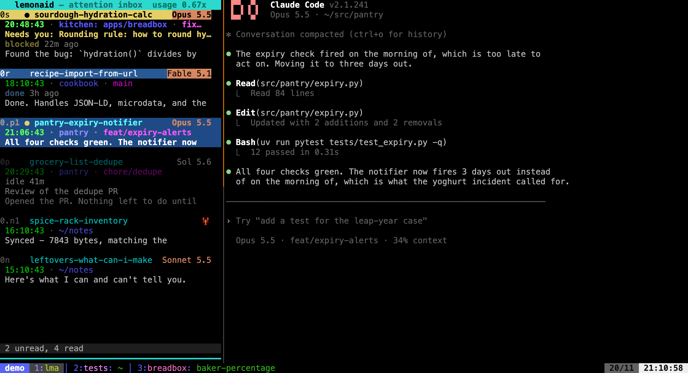
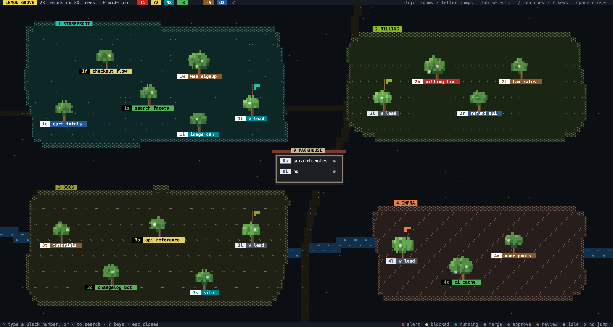

# 🍋🥤 lemonaid

Monitor progress of and switch between lemons (go on... say 'LLMs' three times fast)
running in the terminal.



Hooks in Claude Code, Codex CLI, OpenCode and OpenClaw write a notification
whenever a session stops or needs input. The `lma` inbox shows those sessions,
what each is doing, and jumps you to its tmux pane or WezTerm tab. Archived
sessions stay searchable and resumable.

## The grove

Press `Space` in `lma` and your lemons become a map. Each group is a block of
ground, each terminal session a tree, and each lemon a dot hanging on its tree,
colored by brief status. Nothing moves once it is placed, so you find a lemon by
where it lives. The grove is in beta.



## Install

```bash
uv tool install lemonaid-inbox
```

The package is `lemonaid-inbox`, because `lemonaid` on PyPI is an unrelated
project. The commands are still `lemonaid` and `lma`.

An install made before the rename is a uv tool named `lemonaid`. Remove it
once with `uv tool uninstall lemonaid` before installing `lemonaid-inbox`.

## Documentation

The full README, with setup for each harness and terminal, is on
[GitHub](https://github.com/petergaultney/lemonaid#readme).

- [Docs](https://github.com/petergaultney/lemonaid/tree/main/docs)
- [Changelog](https://github.com/petergaultney/lemonaid/tree/main/changes)
- [Issues](https://github.com/petergaultney/lemonaid/issues)
